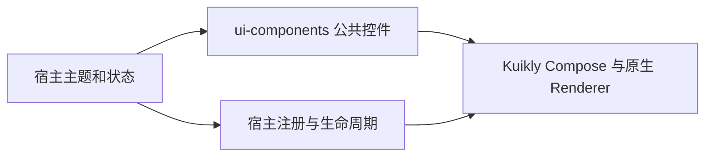

# GY CrossKit UI Components

面向 Kuikly Compose 的公共控件与交互规则，保持既有 `com.dgtang.live.kuikly.core.ui`、`com.dgtang.live.core.ui` 包名。
宿主提供主题、文案、品牌素材、窗口与键盘状态；组件不持有账号、路由或网络业务。

## 架构与调用流程



宿主先提供 `ProvideKuiklyTheme`，控件消费当前主题和输入状态，事件回到宿主更新；Dialog 继承父 CompositionLocal，释放时恢复原生窗口策略。

## 接入

下一正式版本 `1.0.0` 待发布；下列坐标须在该版本公开并通过独立消费后使用。

```kotlin
repositories { maven("https://jitpack.io") }
commonMain.dependencies {
    api("com.github.gycrosskit.ui-components:ui-components:1.0.0")
}
```

```kotlin
import com.dgtang.live.kuikly.core.ui.ProvideKuiklyTheme
import com.dgtang.live.kuikly.core.ui.component.AppText

// colors 由宿主映射自己的品牌主题。
ProvideKuiklyTheme(colors) { AppText("内容") }
```

构建基线 Kotlin `2.2.21-1.0.0`、AGP `8.10.1`、Kuikly `2.30.0-2.0.21-ohos`、coroutines `1.10.2-1.0.0`。
Kuikly API 采用 `prefer` 编译基线，最终版本由宿主统一选择；宿主继续配置 Compose compiler 及匹配的原生 Renderer。
不额外发布 Swift Pod/HAR，不打包第二份 Kotlin runtime 或 JetBrains/AndroidX UI。

源码目标为 Android（minSdk 24，Java 11）、iOS arm64/x64/Simulator arm64、OHOS arm64；该正式版本的 SDK 编译、远程消费与设备验收须绑定对应版本收据。

公共能力、平台补丁和宿主边界见[功能与平台差异](docs/功能与平台差异.md)；构建、测试和精确产物消费见[开发与验证](docs/开发与验证.md)。
反馈请使用 [Issues](https://github.com/gycrosskit/ui-components/issues)，只提供脱敏复现信息。许可证：[Apache-2.0](LICENSE)。
